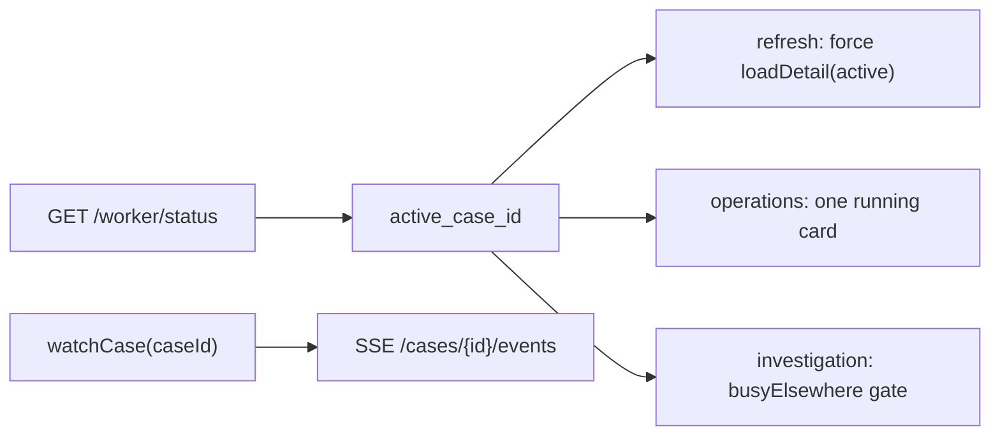

# Composer Phase A — UI discovery report

Prepared in `C:\Projects\suhail-v3-route-ui` on 13 October 2026. Contract reference: `suhail-v3-1` (`approved_frozen`). No application code was changed in this phase; baseline tests were run against the bootstrap tree.

## Checkpoint

| Item | Value |
|---|---|
| Branch | `v3/route-ui` |
| HEAD | `9d6be7bb0c0c3292fbee8ee0c45944ccb56fab00` (matches bootstrap SHA; ancestor check OK) |
| Recording UI import | Committed `frontend-next` from `.ui-integration` `5aab052daead6141bf54fda068f7bd4bdcba3cb2` (per master plan) |
| Bootstrap docs read | `docs/v3/01-master-plan.md`, `06-contract-examples.json`, `08-interface-reference.md`, `11-approved-coordination-addendum.md` |

---

## 1. Current contract inventory (wire → UI)

### Worker / connection (`GET /worker/status`)

**Wire today** (`frontend-next/src/api/contracts.ts` → `ApiWorkerStatus`):

- `worker.state`, `concurrency`, `processed_count`
- Legacy singles: `active_case_id`, `active_shipment_id`, `last_case_id`, `last_workflow_state`
- No `active_count`, no `active_cases[]`, no per-claim fields

**UI mapping** (`api-operations.ts` `refresh()` → `BackendConnection.worker`):

- Internal camelCase: `activeCaseId`, `processedCount`, `lastCaseId` only (`domain/types.ts`)
- `concurrency` from wire is **not** stored on connection
- Poll loop treats **one** active case: only `status.worker.active_case_id` gets forced `loadDetail(id, true)` every poll; other watched cases load once unless stale

**V3 contract** (`06-contract-examples.json`, `08-interface-reference.md`):

- Authoritative list: `worker.active_cases[]` (max configured capacity, sorted)
- `worker.active_count`, legacy IDs null when zero or two active
- Each entry: `case_id`, `shipment_id`, `worker_id`, `claim_id`, `claim_epoch`, `workflow_state`, `run_id`, `run_status`, `active_stage`, wall timestamps, `lease_expires_at`, evidence `as_of`, `state_version`, `final_result`
- Case detail additive: `investigation_status` (same shape; Sol-owned projection)

### Case detail (`GET /cases/{id}`)

**Wire today** (`ApiCaseDetail`):

- `evidence` / `ledger_graph`, `route_layers.layers` with seven keys: `expected_route`, `actual_route`, `vehicle_path`, `custody_points`, `hub_stops`, `delivery_attempts`, `traffic`
- `ApiLayerPoint`: `lat`, `lng`, `entity_id`, `evidence_id`, `occurred_at`, `source`, `vehicle_id`, `package_id`, `disposition` — **no** `recorded_at`, `accuracy_m`, `route_run_id`, `trip_id`, `position_scope`, `source_ref`
- No top-level `route_evidence`
- Pipeline: `pipeline.events`, `investigation_as_of`, `evidence_after_investigation`
- Run: `run`, `last_run_id`, `previous_run`

**View model** (`applyDetail` in `adapters.ts`):

| Backend field | UI surface |
|---|---|
| Route layers | `OperationalCase.route.{expected,actual,vehicle}` as `[lat,lng][]` only |
| Layer points | `EvidenceObservation[]` for map markers (custody, attempts, last 6 vehicle points, optional planned destination) |
| Evidence graph | `GraphNode[]` / `GraphRelationship[]` (bounded `GRAPH_LIMIT` 96) |
| Pipeline | `backend.stage*`, `run.stage`, narration via SSE |

### Live streams (`GET /cases/{id}/events`)

- **Per case id**: `ApiOperationsService.watchCase` opens one `EventSource` per watched case (`watchers` map keyed by `case_id`)
- Events: `pipeline` → `applyPipeline`; `narration` → `applyNarration` (run_id aware for narration only)
- **Cache / identity keys**: `cases` Map by `case_id`; `rowSignature` / `detailSignature` per case; `order[]` for queue sort; `listed` Set for queue membership
- Reconnect: exponential backoff per watcher; closing watcher closes stream

### SSE run fencing (gap vs V3)

- Contract: client should reject stale `run_id` on SSE pipeline frames
- **Today**: `applyPipeline` merges events without comparing `state.run_id` to `base.run?.id` or `base.backend.supersededRunId`; narration already resets on run change
- Reanalysis: `previous_run_id` stored on backend state when `status === "QUEUED"` and no events

---

## 2. Map, graph, and evidence selection (current behavior)

### Route map (`route-map.tsx`)

- **Layers** (toggles): `expected`, `actual`, `vehicle`, `facilities`, `attempts` — aligns with seven backend layers indirectly (actual polyline uses confirmed non-GPS evidence markers, not `layers.actual_route` polyline alone)
- **Expected**: dashed polyline from `c.route.expected`
- **Vehicle**: dashed polyline from `c.route.vehicle` (full path, not bounded to 6)
- **Markers**: from `c.evidence` filtered by kind/layer toggles
- **Selection**: `selected` prop = evidence observation **id**; pan on change; `onSelect(id)`
- **GPS semantics**: tooltip “Vehicle telemetry only”; `confidence: vehicle_only`

### Network map (`network-map.tsx`)

- Explore / fleet view; shipment pin from last confirmed custody or destination city if detail not loaded
- Not on the critical V3 investigation path; reuse layer semantics from case evidence where applicable

### Knowledge graph (`knowledge-graph.tsx`)

- **Selection mapping**: `selectedNode = nodes.find(n => n.id === selected || n.evidenceId === selected)`
- Map click sets `selected` to **evidence list id**; graph highlights when node id matches or `evidenceId` links node to located evidence
- **Located set**: built in adapter — custody/attempt/GPS ids that appear on map; `graphNode.evidenceId` set when `located.has(node.id)`
- **GPS fallback id** (`gps@${occurred_at}`): appears in `evidence[]` and map; **does not** match a graph node unless backend sends matching `evidence_id` on the point and node
- Cited nodes, path mode, focus layout unchanged — Phase B merges `route_evidence.source_nodes` into the same pool with honest edges

### Investigation page (`investigation.tsx`)

- **Case switch**: `useEffect` clears `selected`, relationship, preview stage on `caseId` change
- **Watch**: `watchCase(caseId)` while page open — one stream per open investigation tab
- **Active worker UX**: `busyElsewhere = connection.worker.activeCaseId && activeCaseId !== c.id` disables investigate when **another** case is the single active id
- **Stage focus**: `stageTarget` picks first cited id present in `evidence` or `nodes`

### Operations page (`operations.tsx`)

- **Single running card**: `cases.find(c => c.id === connection.worker.activeCaseId)`
- No display of second concurrent investigation

### Adapter losses (Phase B must address)

| Loss | Where | Impact |
|---|---|---|
| `recorded_at`, `ingested_at` | Not on `ApiLayerPoint` / `EvidenceObservation` | Cannot show receipt vs occurrence or late-upload story |
| `accuracy_m`, `speed_kmh`, `source_ref`, `position_scope` | Not typed or mapped | Detail panel cannot show telemetry quality |
| `route_run_id`, `trip_id`, `assignment_id` | Not on layer points | Cannot label transport context or prevent cross-run joins |
| `route_evidence` block | Absent | Graph/map cannot cite shared GPS sources from additive projection |
| `gps@time` synthetic id | `adapters.ts` ~761–762 | Selectable on map but not a citable source id — **Phase B must omit or block selection without `evidence_id`** |
| `hub_stops`, `traffic` layers | In contract wire, not in `EvidenceObservation` or map toggles as first-class | Layer toggles exist only for five conceptual groups; traffic/hub not exposed in UI toggles |
| Vehicle path on map | Last **6** points in evidence list only; full path in polyline | Timeline/evidence list under-represents long paths |

---

## 3. Parallel investigations — current vs smallest Phase B change

### Current (single active case)

- Multiple SSE streams are **already supported** if multiple pages call `watchCase` (different case ids)
- Queue refresh does **not** keep two actives hot unless both are in `watchers` or manually loaded

### Proposed minimal diff (no redesign)

1. **`contracts.ts` / `types.ts`**: Add `InvestigationStatusV3`, `active_cases`, `active_count`; extend `BackendConnection.worker` with `activeCases: InvestigationStatusV3[]` (and optional `concurrency`, `activeCount`).
2. **`api-operations.ts` `refresh()`**:
   - Map `worker.active_cases` when present; else fall back to legacy single id (length 0/1)
   - `Promise.all` force refresh for **every** active case id (cap 2), not only `active_case_id`
   - Optionally auto-`watchCase` active ids from operations page (ref-count) so both pipelines stream without swapping — **prefer ref-counted watch on operations for active_cases only** to avoid stream swap when user switches investigation tabs
3. **`operations.tsx`**: Render up to two rows/cards from `connection.worker.activeCases` (stage, shipment, `as_of`, worker id), not `find(activeCaseId)`.
4. **`investigation.tsx`**: Replace `busyElsewhere` with backend truth: allow investigate when case is queued **even if** another case is active (backend enqueues); show concurrency from status, disable only per `allowed.investigate` / workflow — remove false “one at a time” UI block when V3 backend supports two workers.
5. **`applyPipeline`**: Ignore pipeline events when `state.run_id` present and ≠ current run (after reanalysis); align with contract.
6. **Case switch**: Already clears selection; ensure async `loadDetail` responses compare `detail.case_id` to current map entry before `put` (verify in Phase B — today signature check helps but race on switch should be explicit).

**Do not** infer two actives from `concurrency === 2`.

---

## 4. Source-selection sketch (consistent with existing design)

1. User selects map marker or graph node → single string `selected` (evidence id or node id).
2. Graph resolves: `id === selected || evidenceId === selected` → highlight node, neighbour path, Canopus context `selectedEvidenceId`.
3. **Phase B rule**: For `kind === "gps"`, set `selected` only if id equals backend `evidence_id` (SYN-*); if point has coordinates but no id, show on polyline only — **not** in selectable evidence list (or disabled marker with “missing source id”).
4. When `route_evidence` present: merge `source_nodes` into graph candidate pool; map observations from `route_evidence.observations` into evidence/route with full timestamps; selecting observation id highlights same id in graph via `evidenceId`.
5. Detail sheet / timeline (Phase B): sort by `occurred_at`; show `recorded_at` on second line; label `investigation_as_of` vs live detail `as_of` when both visible.

---

## 5. Exact Phase B file list (from approved prompt)

Owned edits only:

- `frontend-next/src/api/contracts.ts`, `adapters.ts`
- `frontend-next/src/services/api-operations.ts`
- `frontend-next/src/domain/types.ts`
- `frontend-next/src/state/operations.tsx` (if connection shape exposed)
- `frontend-next/src/pages/operations.tsx`, `pages/investigation.tsx`
- `frontend-next/src/components/route-map.tsx`, `network-map.tsx`, `knowledge-graph.tsx`, `investigation-record.tsx`
- `frontend-next/src/styles/workspace.css` (small)
- Tests: `tests/unit/api-adapters.test.ts`, `api-service.test.ts`, `tests/fixtures/backend.ts`, `tests/e2e-backend/backend-stub.ts`, `connected.spec.ts`, new `v3-evidence.spec.ts`, `v3-concurrency.spec.ts`

---

## 6. Required fields from Sol / Opus (integration dependencies)

### Sol (read model / fixture)

- `GET /worker/status`: `active_cases`, `active_count`; legacy fields per contract
- `GET /cases/{id}`: `route_evidence` (full `RouteEvidenceV3`), enriched `route_layers.layers.vehicle_path` points per `06-contract-examples.json`
- Optional case detail: `investigation_status` projection
- Frozen GPS fixture in deterministic stub for Composer tests (Phase B entry criterion from handoff)

### Opus (`v3/concurrency`)

- Two investigation workers, claim/lease semantics so `active_cases` can hold two entries with distinct `run_id` / `worker_id`
- Backend behavior when second investigation starts (queue vs reject) — UI error string already mentions “another investigation is running” for `processed === false`

### Integrator

- Isolated integration at `http://127.0.0.1:8023/app/` after data available; **not** port 8022 for automation

---

## 7. Contract blockers / ambiguities

| ID | Issue | Owner | Notes |
|---|---|---|---|
| B1 | No fixture/stub V3 worker status or `route_evidence` in repo yet | Sol | Phase B tests need stub extension in owned test files |
| B2 | `applyPipeline` run_id stale rejection specified but not implemented | Composer Phase B | Required for reanalysis |
| B3 | `investigation_status` on case detail vs worker poll | Sol | UI can use worker poll first; detail field optional for drill-down |
| B4 | Hub/traffic layers in wire — UI toggle set incomplete | Composer Phase B | Decide minimal exposure (toggle vs detail-only) without redesign |

No wire-field renames proposed. `suhail-v3-1` is sufficient to implement Phase B once fixture lands.

---

## 8. Baseline test results (Phase A)

Environment: `frontend-next`, `npm ci` fresh, port **5191** free before e2e.

| Command | Result |
|---|---|
| `npm run typecheck` | Pass |
| `npm test -- tests/unit/api-adapters.test.ts tests/unit/api-service.test.ts` | 37/37 pass |
| `npm run build` | Pass (same asset names as pinned recording build: `index-Ct2BapBv.js`, `index-CD_EZO1c.css`) |
| `npm run test:e2e -- tests/e2e-backend/connected.spec.ts` | 17/17 pass |

Not run: `playwright.live.config.ts` (live model / real HTTP investigations prohibited in Phase A).

---

## 9. Phase A code changes

None. Presentation-only fixes were not required for discovered gaps (all are data-contract / Phase B scope).

---

## WORKSTREAM (checkpoint)

**WORKSTREAM:** Composer Phase A — UI discovery  
**BRANCH / HEAD:** `v3/route-ui` @ `9d6be7bb0c0c3292fbee8ee0c45944ccb56fab00` (+ discovery doc commit)  
**COMPLETED:** Contract inventory, map/graph/status analysis, Phase B edit list, source-selection sketch, baseline tests  
**CHANGED FILES:** `docs/v3/composer-phase-a-discovery.md`  
**TESTS RUN / RESULTS:** typecheck OK; unit 37/37; build OK; connected e2e 17/17  
**BLOCKERS:** Sol frozen GPS + V3 stub fields for Phase B implementation/tests  
**INTEGRATION DEPENDENCIES:** Sol `route_evidence` + `active_cases`; Opus two-worker status; integrator 8023 walkthrough after Phase B  
**NEXT ACTION:** Wait for Sol frozen GPS fixture; continue Phase B in this thread  
**READY TO MERGE:** NO (Phase B/C pending; report-only commit)
